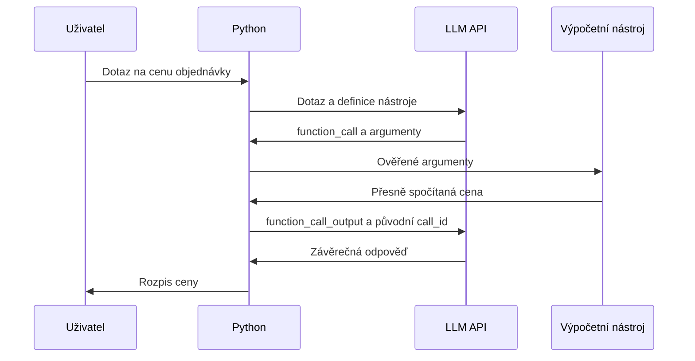

# Úkol 1 – LLM a nástroj pro výpočet ceny objednávky

Python zavolá LLM přes OpenAI Responses API, vykoná vyžádaný výpočet a vrátí
výsledek modelu. Model potom vytvoří závěrečnou odpověď v češtině.

Ukázkový dotaz: **Kolik zaplatím za 12 kusů po 850 Kč se slevou 8 %?**

Očekávaný výpočet: 10 200 Kč před slevou, sleva 816 Kč, konečná cena **9 384 Kč**.
DPH ani doprava se nepřipočítávají. Jednotková cena je konečná cena jednoho kusu.

## Co splňuje zadání

1. `client.responses.create()` v `main.py` zavolá LLM API s definicí nástroje.
2. Model vrátí `function_call` se jménem funkce a argumenty v JSON.
3. Python ověří argumenty a spustí `spocitej_cenu()` z `pricing.py`.
4. Program vrátí `function_call_output` se stejným `call_id` zpět modelu.
5. Další odpověď LLM obsahuje srozumitelný rozpis ceny.



## Instalace ve Windows

Potřebuješ Python 3.12 nebo novější. V terminálu otevři tuto složku
(`01-tool-calling`) a spusť:

```powershell
python -m venv .venv
.\.venv\Scripts\python.exe -m pip install -r requirements.txt
```

Instalace stahuje knihovny z internetu. Aktivace prostředí není potřeba.
Na macOS/Linux použij místo `.\.venv\Scripts\python.exe` příkaz `.venv/bin/python`.

## Nejprve demo bez API klíče

```powershell
.\.venv\Scripts\python.exe demo.py
```

Demo používá skutečný OpenAI SDK klient a skutečný výpočetní nástroj, ale jeho
HTTP transport vrací předem připravené odpovědi místo spojení s poskytovatelem.
Závěrečná věta je také simulovaná a doplní se do ní skutečně spočítaná cena.
**Demo není důkazem živého volání LLM a nenahrazuje živé ověření úkolu.**

## Živé spuštění

Živý běh posílá dotaz poskytovateli a může spotřebovat placené API tokeny.
Přístup k modelu a účtování závisejí na tvém API účtu.

1. Zkopíruj `.env.example` do `.env`:

   ```powershell
   Copy-Item .env.example .env
   ```

2. V místním `.env` vyplň `OPENAI_API_KEY`. `OPENAI_MODEL` určuje model;
   výchozí hodnota je `gpt-5.6-terra`. Musí podporovat Responses API a function calling.
   Klíč nepatří do zdrojového kódu ani do GitHubu; `.env` je v `.gitignore`.
   Už nastavené proměnné prostředí mají přednost před `.env`.
3. Spusť:

   ```powershell
   .\.venv\Scripts\python.exe main.py
   .\.venv\Scripts\python.exe main.py "Kolik stojí 3 kusy po 199,90 Kč se slevou 5 %?"
   ```

Skript vypisuje požadavky na nástroj, argumenty, výsledek výpočtu a závěrečnou
odpověď. Pokud chybí počet kusů nebo cena, model má požádat o doplnění.
Skript řeší jeden dotaz; po upřesnění jej spusť znovu s úplným zadáním.

## Jak je to napsané

| Soubor | Úloha |
| --- | --- |
| `main.py` | Definice nástroje, volání LLM, historie a vrácení výsledku podle `call_id`. |
| `pricing.py` | Kontrola čísel a výpočet peněz pomocí `Decimal`. |
| `demo.py` | Simulace dvou HTTP odpovědí bez volání poskytovatele. |
| `tests/test_assistant.py` | Testy výpočtu a předávání výsledku přes SDK. |

Model navrhuje volání, funkci vykonává Python. Povolena je jediná funkce;
program nespouští libovolný kód od modelu. Chyba nástroje se vrací jako JSON,
aby mohl model opravit argumenty nebo požádat o doplnění.

Peníze mají nejvýše dvě desetinná místa. Sleva se zaokrouhluje na haléře
metodou `ROUND_HALF_UP` a odečítá se od ceny celé objednávky.

Historii drží Python. Používá `store=False`, zachovává všechny výstupní položky
včetně šifrovaného stavu uvažování a nepoužívá `previous_response_id`.
Jde o implementaci pro OpenAI; kompatibilita s jinými poskytovateli není ověřená.
Nejde tedy o hotový test srovnávající GPT a Mistral.

Limit jsou čtyři požadavky na API, každý s výstupním limitem 2 048 tokenů.
Automatická opakování SDK jsou vypnutá. Timeout klienta je nastaven na 30 sekund.

## Ověření

```powershell
.\.venv\Scripts\python.exe -m unittest discover -s tests -v
```

Testy nevyžadují API klíč a nevolají poskytovatele. Ověřují správné peníze,
odmítnutí neplatných argumentů, zachování historie a `call_id`, vrácení chyby
modelu, následnou opravu a ukončení při nedokončené odpovědi či limitu volání.
Živá správnost chování vybraného modelu zůstává samostatným krokem.

## Co umět vysvětlit při odevzdání

- Proč model dostává popis a schéma nástroje, zatímco funkci vykonává Python.
- Proč vracíme výsledek se stejným `call_id` a následně voláme LLM znovu.
- Proč výpočet peněz používá `Decimal` a jak kontrolujeme vstupy od modelu.
- Jaký je rozdíl mezi offline demem a skutečnou odpovědí LLM.

Projekt vznikal s pomocí Codexu. Před odevzdáním je potřeba kód projít,
živě ověřit a respektovat pravidla kurzu pro použití AI.

## Zdroje

- [OpenAI: Function calling](https://developers.openai.com/api/docs/guides/function-calling)
- [OpenAI: Responses API](https://developers.openai.com/api/reference/python/resources/responses/methods/create)
- [OpenAI: GPT-5.6 Terra](https://developers.openai.com/api/docs/models/gpt-5.6-terra)
